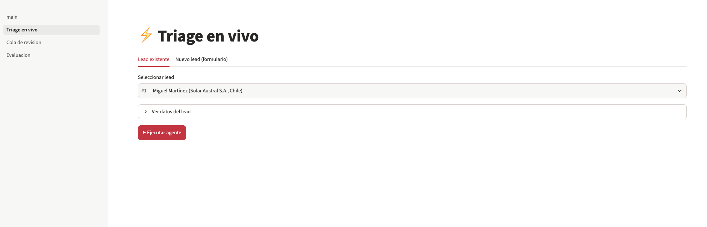
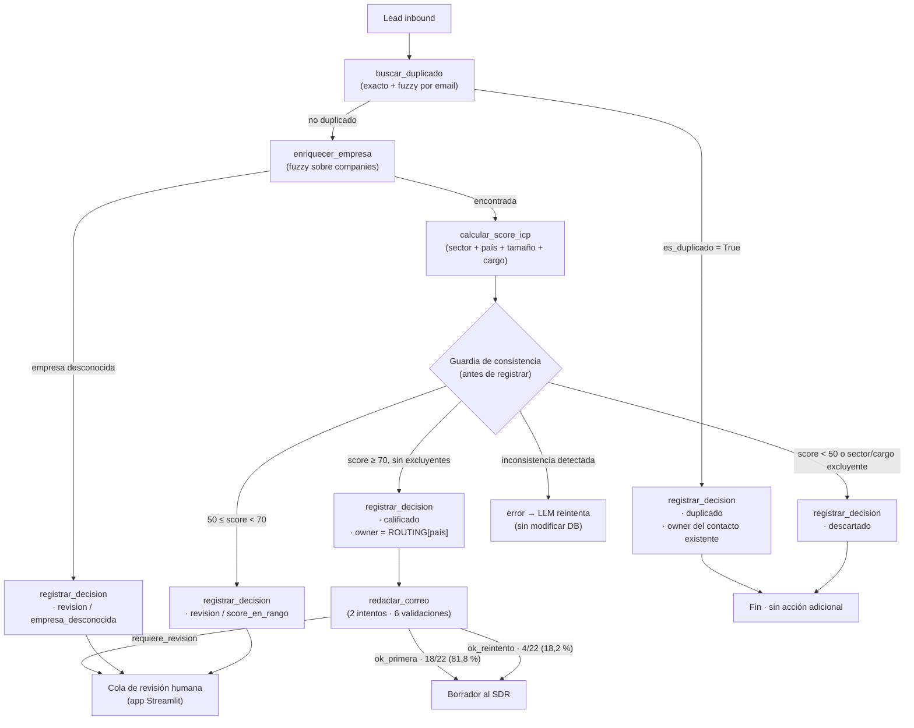
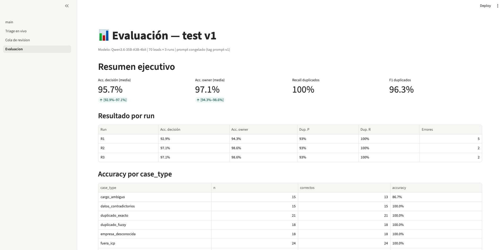
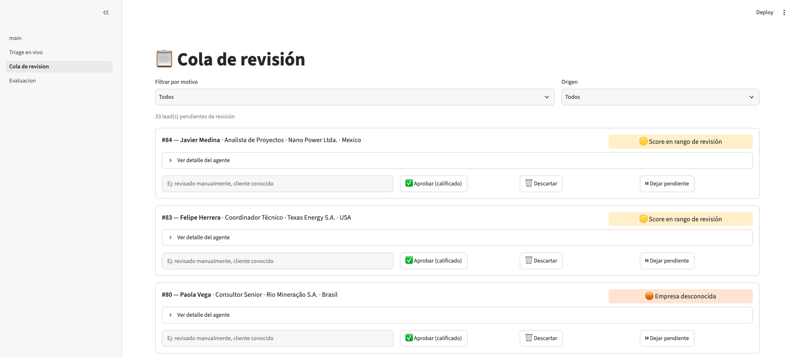

# Lead Triage Agent

[English](README.md) | **Español**

Agente de IA que clasifica leads inbound B2B, asigna un SDR y redacta el primer correo de contacto — con evaluación reproducible y un dashboard para revisión humana.



---

## El problema

En mi experiencia liderando generación de demanda y equipos SDR en B2B, el
inbound tiene un problema silencioso: los leads llegan rápido, pero se procesan
lento. Antes de contactar a nadie, alguien tiene que revisar si el contacto ya
existe en el CRM, si la empresa calza con el ICP y a qué SDR le corresponde.
Ese trabajo manual retrasa la primera respuesta justo cuando el interés del
lead está más alto.

Los errores en esta etapa también cuestan: un duplicado no detectado termina
con dos SDRs contactando a la misma cuenta, y un lead mal calificado consume
tiempo comercial que debería ir a oportunidades reales.

Este proyecto explora si un agente de IA puede hacer ese triage de forma
confiable y, sobre todo, cómo medir si lo hace bien.

---

## Arquitectura

El agente sigue un loop de tool-calling: el LLM decide qué herramienta invocar en cada paso; las herramientas ejecutan lógica determinística en Python y devuelven resultados; el LLM interpreta y decide el siguiente paso. La decisión final se registra solo si pasa la guardia de consistencia.



### Componentes

| Capa | Archivo | Responsabilidad |
|------|---------|-----------------|
| Loop del agente | `src/agent/loop.py` | Llama al modelo, ejecuta tool calls, mantiene historial, aplica guardia |
| Herramientas | `src/agent/tools.py` | `buscar_duplicado`, `enriquecer_empresa`, `calcular_score_icp`, `registrar_decision` |
| Reglas de negocio | `src/agent/rules.py` + `config/business_rules.yaml` | Constantes ICP, umbrales, routing de SDRs — única fuente de verdad |
| Redactor de correos | `src/email/drafter.py` | 2 intentos con 6 validaciones determinísticas |
| CRM simulado | `data/crm.db` | SQLite: `inbound_leads`, `companies`, `crm_contacts`, `agent_decisions`, `email_drafts`, `human_overrides` |
| Evaluación | `eval/run_eval.py` | Corre N repeticiones, separa errores de sistema, genera reporte Markdown + CSV |
| Dashboard | `app/` | Streamlit: triage en vivo, cola de revisión humana, métricas de test |

---

## Decisiones de diseño

### El LLM orquesta; los cálculos los hace Python

El modelo decide *qué* herramienta invocar y en qué orden. Los valores numéricos (score ICP, umbrales, routing) los calculan funciones Python determinísticas que leen de la DB por `lead_id`. El LLM nunca reenvía valores intermedios: `calcular_score_icp` acepta `lead_id` + `nombre_empresa` y recupera `sector`, `país` y `empleados` directamente de `companies`, así que el score registrado es siempre el que calculó la herramienta.

### El owner es determinístico

`registrar_decision` calcula el owner internamente (`_compute_owner`) a partir de la decisión y el país de la empresa. No es un parámetro que provea el LLM: el routing de SDRs es una regla de negocio explícita, y dejarlo en manos del modelo arriesga asignaciones inventadas o inconsistentes.

### Guardia de consistencia antes de registrar

`_check_consistency` valida que la decisión propuesta sea coherente con los resultados de las herramientas de esa misma ejecución: no puede registrar `calificado` sin haber llamado a `calcular_score_icp`, ni `duplicado` si `buscar_duplicado` no encontró match, ni `revision/score_en_rango_revision` si el score supera el umbral de calificado. En vez de dejar pasar un resultado "mal recordado", la guardia lo convierte en feedback inmediato al modelo.

### `revision` requiere motivo de lista cerrada

Motivos válidos: `score_en_rango_revision`, `empresa_desconocida`, `datos_contradictorios`. El contenido descargado no es criterio de revisión (regla explícita en el system prompt). `datos_contradictorios` requiere además un campo `evidencia` con los dos datos en conflicto. Un motivo libre ("no estoy seguro") no le sirve a quien revisa la cola; la lista cerrada obliga al agente a identificar la causa real.

### Split dev/test rígido y test corrido una sola vez

100 leads con ground truth derivado de reglas, split 30/70 (dev/test). Dev se usa para iterar el prompt; test se corre una única vez con el prompt congelado en el tag `prompt-v1`. Correr test varias veces ajustaría implícitamente el prompt a esos 70 casos.

### Tres corridas por evaluación

Cada evaluación lanza el agente N veces sobre los mismos leads y reporta media y rango `[min, max]`. Qwen3 con temperatura 0.6 varía entre corridas; tres runs distinguen errores reproducibles (el mismo lead falla siempre) de errores estocásticos (falla 1 de 3).

### Temperatura 0.6 / top_p 0.95, no 0

Qwen3 en modo pensamiento necesita temperatura > 0 para generar razonamiento interno; con temperatura 0 responde sin `reasoning_content`. Ese razonamiento mejora la orquestación y se muestra en el dashboard para trazabilidad.

### Errores de sistema excluidos de la accuracy

`error_sistema` se registra cuando una excepción Python no atribuible al LLM interrumpe la ejecución (timeout de red, fallo de DB, etc.). Esos casos se reportan aparte y se excluyen del denominador, para que las fallas de infraestructura no distorsionen la medición del juicio del modelo.

---

## Metodología de evaluación

### Ground truth por reglas

El ground truth (`eval/ground_truth.csv`) se genera con `scripts/generate_data.py` (seed = 42). Cada lead tiene `case_type`, `decision` esperada y `owner_esperado` derivados de las mismas reglas de negocio que usa el agente. No hay etiquetado manual. Esto garantiza consistencia entre el criterio de evaluación y la implementación, pero implica que se mide fidelidad a las reglas, no calidad de negocio real.

### Sets

| Set | Leads | Uso |
|-----|------:|-----|
| dev | 30 | Desarrollo e iteración del prompt |
| test | 70 | Medición final, corrido una sola vez |

Cada run tiene un `run_id` único (`{set}_{model}_{fecha}_R{n}`). El script computa métricas por run, agrega media y rango, y genera un reporte Markdown + CSV de errores.

### Qué se mide

- **Accuracy de decisión:** proporción de leads cuya decisión coincide con el ground truth, excluyendo errores de sistema.
- **Accuracy de owner:** ídem para el SDR asignado.
- **F1 de duplicados:** precision/recall/F1 sobre los leads `duplicado`.
- **Tasa de escalamiento:** proporción de leads con decisión `revision`.
- **Guardia de consistencia activada:** veces que `_check_consistency` rechazó un intento de `registrar_decision`.
- **Fallbacks por step_limit:** veces que el loop alcanzó MAX\_STEPS sin decisión final.
- **Errores de sistema:** fallos de infraestructura, excluidos de accuracy.

---

## Resultados — test v1

> Set test · 70 leads · 3 runs · prompt-v1 congelado · Qwen3.6-35B-A3B-4bit · T=0.6 / top_p=0.95



### Resumen ejecutivo

| Métrica | Media | [min, max] |
|---------|------:|:----------:|
| Accuracy de decisión | **95,7 %** | [92,9 %, 97,1 %] |
| Accuracy de owner | **97,1 %** | [94,3 %, 98,6 %] |
| Precision duplicados | 92,9 % | — |
| Recall duplicados | **100,0 %** | — |
| F1 duplicados | 96,3 % | — |
| Tasa de escalamiento | 28,6 % | [27,1 %, 31,4 %] |
| Guardia de consistencia activada | 0,3 /run | [0,0, 1,0] |
| Fallbacks por step_limit | 2,7 /run | [2,0, 4,0] |
| Errores de sistema | 0,0 | — |
| Pasos promedio | 3,37 | [3,27, 3,46] |
| Latencia promedio | 24,7 s/lead | [18,3, 34,3] |

### Resultado por run

| Run | Acc. decisión | Acc. owner | Dup. F1 | Pasos | Latencia | Errores |
|:---:|:-------------:|:----------:|:-------:|------:|---------:|:-------:|
| R1 | 92,9 % | 94,3 % | 96 % | 3,3 | 34,3 s | 5 |
| R2 | 97,1 % | 98,6 % | 96 % | 3,4 | 21,5 s | 2 |
| R3 | 97,1 % | 98,6 % | 96 % | 3,5 | 18,3 s | 2 |

### Accuracy por case_type (agregada, 3 runs)

| case_type | Descripción | Leads | n (×3) | Correctos | Accuracy |
|-----------|-------------|------:|-------:|----------:|:--------:|
| datos_contradictorios | País vs. dominio de email inconsistentes | 5 | 15 | 15 | **100,0 %** |
| duplicado_exacto | Email idéntico al CRM | 7 | 21 | 21 | **100,0 %** |
| duplicado_fuzzy | Email similar (typo o variante) | 6 | 18 | 18 | **100,0 %** |
| empresa_desconocida | Empresa sin match en `companies` | 6 | 18 | 18 | **100,0 %** |
| fuera_icp | Sector o país fuera del ICP | 8 | 24 | 24 | **100,0 %** |
| normal | Lead estándar con toda la información | 33 | 99 | 92 | 92,9 % |
| cargo_ambiguo | Cargo que puede ser decisor o no | 5 | 15 | 13 | 86,7 % |

### Errores por origen (9 instancias en 6 leads únicos)

| Origen | Leads únicos | Instancias | Reproducible |
|--------|:------------:|:----------:|:------------:|
| Orquestación — respuesta sin `tool_calls` → fallback `step_limit` | 4 (#43, #78, #80, #94) | 5 | No (1–2/3 runs) |
| Herramienta determinística — umbral fuzzy demasiado bajo | 1 (#72) | 3 | Sí (3/3 runs) |
| Juicio del LLM — regla del prompt ignorada | 1 (#45) | 1 | No (1/3 runs) |

- **#43, #78, #80, #94 (orquestación):** en alguna corrida el modelo emitió texto plano sin `tool_calls`; el loop lo interpretó como fin de turno y activó el fallback `step_limit → revision`. Las corridas que completaron el flujo dieron la decisión correcta.
- **#72 (herramienta):** `buscar_duplicado` marca a Natalia Sánchez (`natalia.sanchez@patagoniawind.com`) como duplicada de Natalia Silva (`natalia.silva@patagoniawind.com`) porque `fuzz.ratio = 87,5 % > umbral 85 %`. Son personas distintas del mismo dominio. El LLM actúa bien según el resultado de la herramienta; el error está en el umbral.
- **#45 (juicio):** el modelo obtuvo `score=80` (calificado) pero razonó que el contenido descargado contradecía el país del lead y registró `revision/datos_contradictorios`, aunque el system prompt dice que el contenido descargado no es criterio.

La accuracy de owner (97,1 %) es mayor que la de decisión (95,7 %) porque #72 produce una *decisión* incorrecta pero el *owner* correcto: tanto `duplicado` como `calificado` llevan al mismo SDR (Ana Torres, dueña del contacto en CRM y responsable de Argentina).

Análisis completo: [`docs/analisis_errores_test.md`](docs/analisis_errores_test.md).

### Correos (R3 de test)

22 leads calificados en R3 → 22 borradores generados (cobertura 100 %).

| Estado | n | % | Intentos |
|--------|--:|:-:|:--------:|
| `ok_primera` | 18 | 81,8 % | 1 |
| `ok_reintento` | 4 | 18,2 % | 2 |
| `requiere_revision` | 0 | 0,0 % | — |

Cada borrador pasa 6 validaciones determinísticas: largo del cuerpo (≤ 120 palabras), largo del asunto (≤ 8 palabras), idioma (español / portugués según país), mención de la empresa, firma con el nombre del SDR y ausencia de cifras que no estén en los datos de entrada. Si el primer intento falla, el prompt del segundo incluye el error específico.

La revisión humana de los borradores está disponible en la cola del dashboard, pero aún no tiene registros: el flujo de aprobación manual no se ejecutó sobre este set.



---

## Lo que aprendí

**1. La mayoría de los errores no fueron del modelo.** De los 9 errores en
test, solo 1 fue un error de juicio del LLM. Cinco vinieron del orquestador
(tratar una respuesta sin herramienta como fin del turno) y tres de una
herramienta determinística (un umbral de similitud mal calibrado). Mejorar
un agente es, en gran parte, mejorar el sistema que lo rodea.

**2. El LLM orquesta; el código mueve los datos.** Cuando el modelo copiaba
valores entre herramientas, reescribía "mineria" como "minería" y el score
caía de 80 a 40. En otro caso inventó un SDR que no existía. La solución no
fue un mejor prompt, sino quitarle esas tareas: las herramientas leen los
datos directamente y el owner lo calcula el código.

**3. Una evaluación tiene que distinguir "el modelo falló" de "el sistema
falló".** Un error de base de datos hizo que el agente reintentara una
decisión correcta hasta agotarse, y eso se registró como error del modelo.
Más tarde, un typo en el nombre del modelo generó un 25,7 % de accuracy
falso: los leads que nunca se procesaron se contaban como aciertos por
coincidencia.

**4. Hay que validar todo, incluidos los validadores.** El ground truth
tenía errores ("coo" coincidía con "coordinador"; las formas femeninas de
los cargos no se reconocían). El validador de correos rechazaba el 100 % de
los borradores a la primera por un falso positivo. Ninguna pieza del sistema
merece confianza ciega.

**5. Separar dev y test cambia la historia.** En dev, el agente logró 100 %;
en test, 95,7 %. Sin esa separación habría reportado un número inflado por mi
propio ajuste del prompt.

**6. Las reglas de negocio son el producto.** Las mejoras más importantes
no fueron técnicas: definir criterios excluyentes del ICP, una lista cerrada
de motivos de revisión y que los duplicados vuelvan a su owner existente.
Ahí es donde la experiencia en RevOps importa más que el modelo.

---

## Limitaciones

- **Datos 100 % sintéticos.** Empresas, personas, emails y contenidos son ficticios, generados con seed fija. Los leads reales traen ruido, formatos inesperados, nombres de empresa ambiguos y contextos fuera del ICP diseñado.
- **Un solo modelo local.** Solo se usó Qwen3.6-35B-A3B-4bit en oMLX local; no hay comparación entre modelos, tamaños ni providers.
- **Una sola versión del prompt evaluada en test.** 70 casos es un conjunto pequeño; los resultados podrían no generalizar a otras distribuciones de leads o a casos edge no representados.
- **CRM en SQLite sin historial ni oportunidades.** Un agente real necesitaría integración con un CRM real (HubSpot, Salesforce) y contexto de relación previa.
- **Latencia de 24,7 s/lead.** Procesar 100 leads nuevos tomaría ~41 minutos; para volúmenes altos haría falta un modelo más rápido o procesamiento en paralelo.
- **El ground truth mide fidelidad a las reglas, no valor de negocio.** No indica si las reglas son las correctas, si el ICP está bien definido ni si los leads `calificado` convierten.

---

## Cómo ejecutarlo desde cero

### Requisitos

- Python 3.11
- [oMLX](https://github.com/ml-explore/mlx-lm) corriendo localmente con un modelo compatible (p. ej. `Qwen3.6-35B-A3B-4bit`)

### Instalación

```bash
# 1. Clonar
git clone <repo-url>
cd lead-triage-agent

# 2. Crear entorno
conda create -n leadagent python=3.11
conda activate leadagent
pip install -r requirements.txt

# 3. Variables de entorno
cp .env.example .env
# Editar .env:
#   OMLX_BASE_URL=http://127.0.0.1:8000/v1
#   OMLX_API_KEY=<tu-api-key>
#   MODEL_ID=Qwen3.6-35B-A3B-4bit

# 4. Generar datos sintéticos y CRM (seed=42, reproducible)
python scripts/generate_data.py
```

### Uso

```bash
# Dashboard (http://localhost:8501)
streamlit run app/main.py

# Evaluar en dev (30 leads, iterable)
python eval/run_eval.py --set dev --model Qwen3.6-35B-A3B-4bit --runs 3

# Evaluar en test — correr UNA SOLA VEZ con el prompt congelado
python eval/run_eval.py --set test --model Qwen3.6-35B-A3B-4bit --runs 3

# Generar borradores para todos los leads calificados del último run de test
python scripts/draft_emails.py

# Tests unitarios
pytest -v
```

### Estructura del proyecto

```
lead-triage-agent/
├── app/                    # Dashboard Streamlit
│   ├── main.py
│   ├── db.py
│   └── pages/
│       ├── 1_Triage_en_vivo.py
│       ├── 2_Cola_de_revision.py
│       └── 3_Evaluacion.py
├── config/
│   └── business_rules.yaml # Umbrales ICP, routing, reglas de correo
├── data/
│   └── crm.db              # SQLite (generado por generate_data.py)
├── docs/
│   ├── img/                # Capturas del dashboard
│   ├── analisis_errores_test.md
│   ├── lecciones.md
│   └── revision_humana_correos.md
├── eval/
│   ├── ground_truth.csv
│   ├── run_eval.py
│   ├── split.json
│   └── results/
├── prompts/
│   ├── systems_prompt.md
│   └── email_prompt.md
├── scripts/
│   ├── generate_data.py
│   └── draft_emails.py
├── src/
│   ├── agent/
│   │   ├── loop.py
│   │   ├── tools.py
│   │   └── rules.py
│   └── email/
│       └── drafter.py
├── tests/
└── requirements.txt
```
