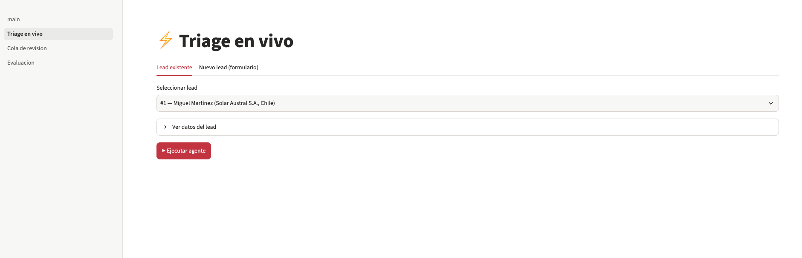
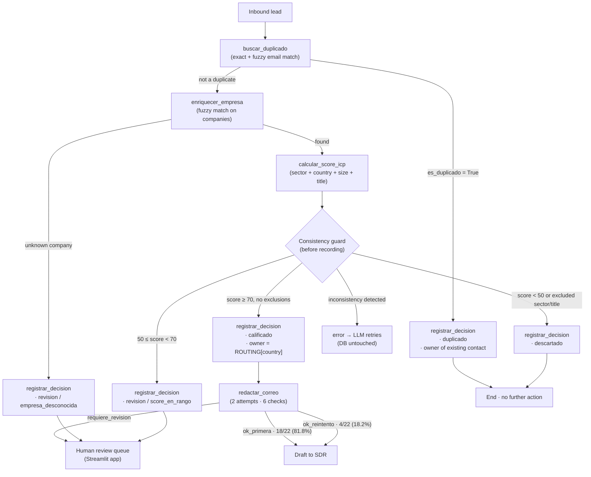
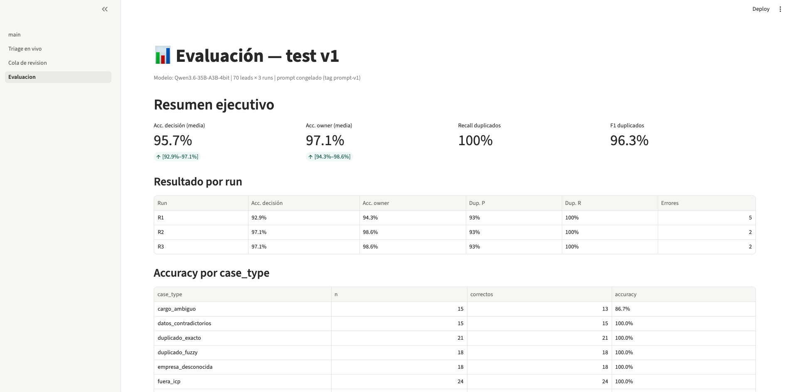
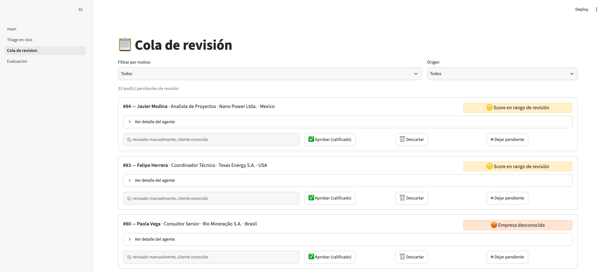

# Lead Triage Agent

**English** | [Español](README.es.md)

AI agent that triages inbound B2B leads, assigns an SDR and drafts the first outreach email — with reproducible evaluation and a dashboard for human review.



---

## The problem

In my experience leading demand generation and SDR teams in B2B, inbound has a
silent problem: leads arrive fast but get processed slowly. Before anyone
reaches out, someone has to check whether the contact already exists in the
CRM, whether the company fits the ICP and which SDR it belongs to. That manual
work delays the first response exactly when the lead's interest is highest.

Mistakes at this stage are costly too: an undetected duplicate ends with two
SDRs contacting the same account, and a poorly qualified lead consumes sales
time that should go to real opportunities.

This project explores whether an AI agent can do that triage reliably — and,
above all, how to measure whether it does it well.

---

## Architecture

The agent runs a tool-calling loop: at each step the LLM decides which tool to call; tools run deterministic Python logic and return results; the LLM interprets them and picks the next step. The final decision is only recorded if it passes the consistency guard.



> Tool names, decisions and reasons are kept in Spanish, as they appear in the code.

### Components

| Layer | File | Responsibility |
|-------|------|----------------|
| Agent loop | `src/agent/loop.py` | Calls the model, executes tool calls, keeps history, applies the guard |
| Tools | `src/agent/tools.py` | `buscar_duplicado`, `enriquecer_empresa`, `calcular_score_icp`, `registrar_decision` |
| Business rules | `src/agent/rules.py` + `config/business_rules.yaml` | ICP constants, thresholds, SDR routing — single source of truth |
| Email drafter | `src/email/drafter.py` | 2 attempts with 6 deterministic checks |
| Simulated CRM | `data/crm.db` | SQLite: `inbound_leads`, `companies`, `crm_contacts`, `agent_decisions`, `email_drafts`, `human_overrides` |
| Evaluation | `eval/run_eval.py` | Runs N repetitions, separates system errors, writes Markdown report + CSV |
| Dashboard | `app/` | Streamlit: live triage, human review queue, test metrics |

---

## Design decisions

### The LLM orchestrates; Python does the math

The model decides *which* tool to call and in what order. Numeric values (ICP score, thresholds, routing) are computed by deterministic Python functions that read from the DB by `lead_id`. The LLM never relays intermediate values: `calcular_score_icp` takes `lead_id` + `nombre_empresa` and fetches `sector`, `country` and `employees` from `companies` itself, so the recorded score is always the one the tool computed.

### The owner is deterministic

`registrar_decision` computes the owner internally (`_compute_owner`) from the decision and the company's country. It is not a parameter the LLM provides: SDR routing is an explicit business rule, and letting the model choose it risks invented or inconsistent assignments.

### Consistency guard before recording

`_check_consistency` checks that the proposed decision matches the tool results from that same run: it cannot record `calificado` without having called `calcular_score_icp`, `duplicado` if `buscar_duplicado` found no match, or `revision/score_en_rango_revision` if the score exceeds the qualified threshold. Instead of letting a misremembered result through, the guard turns it into immediate feedback to the model.

### `revision` requires a reason from a closed list

Valid reasons: `score_en_rango_revision`, `empresa_desconocida`, `datos_contradictorios`. Downloaded content is not a review criterion (explicit rule in the system prompt). `datos_contradictorios` also requires an `evidencia` field with the two conflicting data points. A free-form reason ("not sure") is useless to whoever works the queue; a closed list forces the agent to name the actual cause.

### Strict dev/test split, test run only once

100 leads with rule-derived ground truth, split 30/70 (dev/test). Dev is used to iterate the prompt; test is run once, with the prompt frozen at tag `prompt-v1`. Re-running test would implicitly tune the prompt to those 70 cases.

### Three runs per evaluation

Each evaluation runs the agent N times over the same leads and reports mean and `[min, max]`. Qwen3 at temperature 0.6 varies between runs; three runs separate reproducible errors (same lead fails every time) from stochastic ones (fails 1 in 3).

### Temperature 0.6 / top_p 0.95, not 0

Qwen3 in thinking mode needs temperature > 0 to produce internal reasoning; at temperature 0 it answers without `reasoning_content`. That reasoning improves orchestration and is shown in the dashboard for traceability.

### System errors excluded from accuracy

`error_sistema` is recorded when a Python exception not attributable to the LLM interrupts the run (network timeout, DB failure, etc.). These cases are reported separately and excluded from the accuracy denominator, so infrastructure failures don't distort the measurement of the model's judgment.

---

## Evaluation methodology

### Rule-based ground truth

The ground truth (`eval/ground_truth.csv`) is generated by `scripts/generate_data.py` (seed = 42). Each lead has a `case_type`, an expected `decision` and an `owner_esperado` derived from the same business rules the agent uses. There is no manual labeling. This guarantees the evaluation criterion matches the implementation, but it means the evaluation measures fidelity to the rules, not real business quality.

### Sets

| Set | Leads | Use |
|-----|------:|-----|
| dev | 30 | Development and prompt iteration |
| test | 70 | Final measurement, run only once |

Each run gets a unique `run_id` (`{set}_{model}_{date}_R{n}`). The script computes per-run metrics, aggregates mean and range, and writes a Markdown report plus an error CSV.

### What is measured

- **Decision accuracy:** share of leads whose decision matches the ground truth, excluding system errors.
- **Owner accuracy:** same, for the assigned SDR.
- **Duplicate F1:** precision/recall/F1 on `duplicado` leads.
- **Escalation rate:** share of leads with decision `revision`.
- **Consistency guard triggers:** times `_check_consistency` rejected a `registrar_decision` attempt.
- **step_limit fallbacks:** times the loop hit MAX\_STEPS without a final decision.
- **System errors:** infrastructure failures, excluded from accuracy.

---

## Results — test v1

> Test set · 70 leads · 3 runs · frozen prompt-v1 · Qwen3.6-35B-A3B-4bit · T=0.6 / top_p=0.95



### Summary

| Metric | Mean | [min, max] |
|--------|-----:|:----------:|
| Decision accuracy | **95.7%** | [92.9%, 97.1%] |
| Owner accuracy | **97.1%** | [94.3%, 98.6%] |
| Duplicate precision | 92.9% | — |
| Duplicate recall | **100.0%** | — |
| Duplicate F1 | 96.3% | — |
| Escalation rate | 28.6% | [27.1%, 31.4%] |
| Consistency guard triggers | 0.3 /run | [0.0, 1.0] |
| step_limit fallbacks | 2.7 /run | [2.0, 4.0] |
| System errors | 0.0 | — |
| Avg. steps | 3.37 | [3.27, 3.46] |
| Avg. latency | 24.7 s/lead | [18.3, 34.3] |

### Per run

| Run | Decision acc. | Owner acc. | Dup. F1 | Steps | Latency | Errors |
|:---:|:-------------:|:----------:|:-------:|------:|--------:|:------:|
| R1 | 92.9% | 94.3% | 96% | 3.3 | 34.3 s | 5 |
| R2 | 97.1% | 98.6% | 96% | 3.4 | 21.5 s | 2 |
| R3 | 97.1% | 98.6% | 96% | 3.5 | 18.3 s | 2 |

### Accuracy by case_type (3 runs aggregated)

| case_type | Description | Leads | n (×3) | Correct | Accuracy |
|-----------|-------------|------:|-------:|--------:|:--------:|
| datos_contradictorios | Country vs. email domain mismatch | 5 | 15 | 15 | **100.0%** |
| duplicado_exacto | Email identical to CRM | 7 | 21 | 21 | **100.0%** |
| duplicado_fuzzy | Similar email (typo or variant) | 6 | 18 | 18 | **100.0%** |
| empresa_desconocida | Company not found in `companies` | 6 | 18 | 18 | **100.0%** |
| fuera_icp | Sector or country outside the ICP | 8 | 24 | 24 | **100.0%** |
| normal | Standard lead with full information | 33 | 99 | 92 | 92.9% |
| cargo_ambiguo | Title that may or may not be a decision-maker | 5 | 15 | 13 | 86.7% |

### Errors by source (9 instances across 6 unique leads)

| Source | Unique leads | Instances | Reproducible |
|--------|:------------:|:---------:|:------------:|
| Orchestration — response without `tool_calls` → `step_limit` fallback | 4 (#43, #78, #80, #94) | 5 | No (1–2/3 runs) |
| Deterministic tool — fuzzy threshold too low | 1 (#72) | 3 | Yes (3/3 runs) |
| LLM judgment — prompt rule ignored | 1 (#45) | 1 | No (1/3 runs) |

- **#43, #78, #80, #94 (orchestration):** in some runs the model emitted plain text without `tool_calls`; the loop treated it as end of turn and fell back to `step_limit → revision`. Runs that completed the flow produced the correct decision.
- **#72 (tool):** `buscar_duplicado` flags Natalia Sánchez (`natalia.sanchez@patagoniawind.com`) as a duplicate of Natalia Silva (`natalia.silva@patagoniawind.com`) because `fuzz.ratio = 87.5% > 85% threshold`. They are different people on the same domain. The LLM acted correctly on the tool's output; the bug is the threshold.
- **#45 (judgment):** the model got `score=80` (qualified) but reasoned that the downloaded content contradicted the lead's country and recorded `revision/datos_contradictorios`, despite the system prompt saying downloaded content is not a criterion.

Owner accuracy (97.1%) is higher than decision accuracy (95.7%) because #72 yields a wrong *decision* but the right *owner*: both `duplicado` and `calificado` route to the same SDR (Ana Torres, owner of the CRM contact and responsible for Argentina).

Full analysis: [`docs/analisis_errores_test.md`](docs/analisis_errores_test.md) (Spanish).

### Email drafts (test R3)

22 qualified leads in R3 → 22 drafts generated (100% coverage).

| Status | n | % | Attempts |
|--------|--:|:-:|:--------:|
| `ok_primera` | 18 | 81.8% | 1 |
| `ok_reintento` | 4 | 18.2% | 2 |
| `requiere_revision` | 0 | 0.0% | — |

Each draft passes 6 deterministic checks: body length (≤ 120 words), subject length (≤ 8 words), language (Spanish / Portuguese by country), company mention, signature with the SDR's name, and no figures absent from the input data. If the first attempt fails, the second attempt's prompt includes the specific error.

Human review of drafts is available in the dashboard queue but has no records yet: the manual approval flow was not run on this set.



---

## Lessons learned

**1. Most errors weren't the model's.** Of the 9 errors in test, only 1 was an
LLM judgment error. Five came from the orchestrator (treating a response
without a tool call as end of turn) and three from a deterministic tool (a
miscalibrated similarity threshold). Improving an agent is largely improving
the system around it.

**2. The LLM orchestrates; code moves the data.** When the model copied values
between tools, it rewrote "mineria" as "minería" and the score dropped from 80
to 40. In another case it invented an SDR who didn't exist. The fix wasn't a
better prompt but taking those tasks away from it: tools read the data directly
and code computes the owner.

**3. An evaluation must distinguish "the model failed" from "the system
failed".** A database error made the agent retry a correct decision until it
ran out of steps, and that was logged as a model error. Later, a typo in the
model name produced a fake 25.7% accuracy: leads that were never processed
counted as correct by coincidence.

**4. Validate everything, including the validators.** The ground truth had
bugs ("coo" matched "coordinador"; feminine forms of job titles weren't
recognized). The email validator rejected 100% of first drafts because of a
false positive. No piece of the system deserves blind trust.

**5. Separating dev and test changes the story.** On dev the agent hit 100%; on
test, 95.7%. Without that split I would have reported a number inflated by my
own prompt tuning.

**6. Business rules are the product.** The most important improvements weren't
technical: defining ICP exclusion criteria, a closed list of review reasons,
and routing duplicates back to their existing owner. That's where RevOps
experience matters more than the model.

---

## Limitations

- **100% synthetic data.** Companies, people, emails and content are fictional, generated with a fixed seed. Real leads bring noise, unexpected formats, ambiguous company names and contexts outside the designed ICP.
- **A single local model.** Only Qwen3.6-35B-A3B-4bit on local oMLX was used; there is no comparison across models, sizes or providers.
- **One prompt version evaluated on test.** 70 cases is a small set; results may not generalize to other lead distributions or unrepresented edge cases.
- **SQLite CRM without history or opportunities.** A real agent would need integration with a real CRM (HubSpot, Salesforce) and prior relationship context.
- **24.7 s/lead latency.** Processing 100 new leads would take ~41 minutes; high volumes would need a faster model or parallel processing.
- **Ground truth measures rule fidelity, not business value.** It doesn't tell whether the rules are right, whether the ICP is well defined, or whether `calificado` leads actually convert.

---

## Running it from scratch

### Requirements

- Python 3.11
- [oMLX](https://github.com/ml-explore/mlx-lm) running locally with a compatible model (e.g. `Qwen3.6-35B-A3B-4bit`)

### Setup

```bash
# 1. Clone
git clone <repo-url>
cd lead-triage-agent

# 2. Environment
conda create -n leadagent python=3.11
conda activate leadagent
pip install -r requirements.txt

# 3. Environment variables
cp .env.example .env
# Edit .env:
#   OMLX_BASE_URL=http://127.0.0.1:8000/v1
#   OMLX_API_KEY=<your-api-key>
#   MODEL_ID=Qwen3.6-35B-A3B-4bit

# 4. Generate synthetic data and CRM (seed=42, reproducible)
python scripts/generate_data.py
```

### Usage

```bash
# Dashboard (http://localhost:8501)
streamlit run app/main.py

# Evaluate on dev (30 leads, iterate freely)
python eval/run_eval.py --set dev --model Qwen3.6-35B-A3B-4bit --runs 3

# Evaluate on test — run ONCE, with the prompt frozen
python eval/run_eval.py --set test --model Qwen3.6-35B-A3B-4bit --runs 3

# Draft emails for every qualified lead in the latest test run
python scripts/draft_emails.py

# Unit tests
pytest -v
```

### Project structure

```
lead-triage-agent/
├── app/                    # Streamlit dashboard
│   ├── main.py
│   ├── db.py
│   └── pages/
│       ├── 1_Triage_en_vivo.py
│       ├── 2_Cola_de_revision.py
│       └── 3_Evaluacion.py
├── config/
│   └── business_rules.yaml # ICP thresholds, routing, email rules
├── data/
│   └── crm.db              # SQLite (generated by generate_data.py)
├── docs/
│   ├── img/                # Dashboard screenshots
│   ├── analisis_errores_test.md
│   ├── lecciones.md
│   └── revision_humana_correos.md
├── eval/
│   ├── ground_truth.csv
│   ├── run_eval.py
│   ├── split.json
│   └── results/
├── prompts/
│   ├── systems_prompt.md
│   └── email_prompt.md
├── scripts/
│   ├── generate_data.py
│   └── draft_emails.py
├── src/
│   ├── agent/
│   │   ├── loop.py
│   │   ├── tools.py
│   │   └── rules.py
│   └── email/
│       └── drafter.py
├── tests/
└── requirements.txt
```
