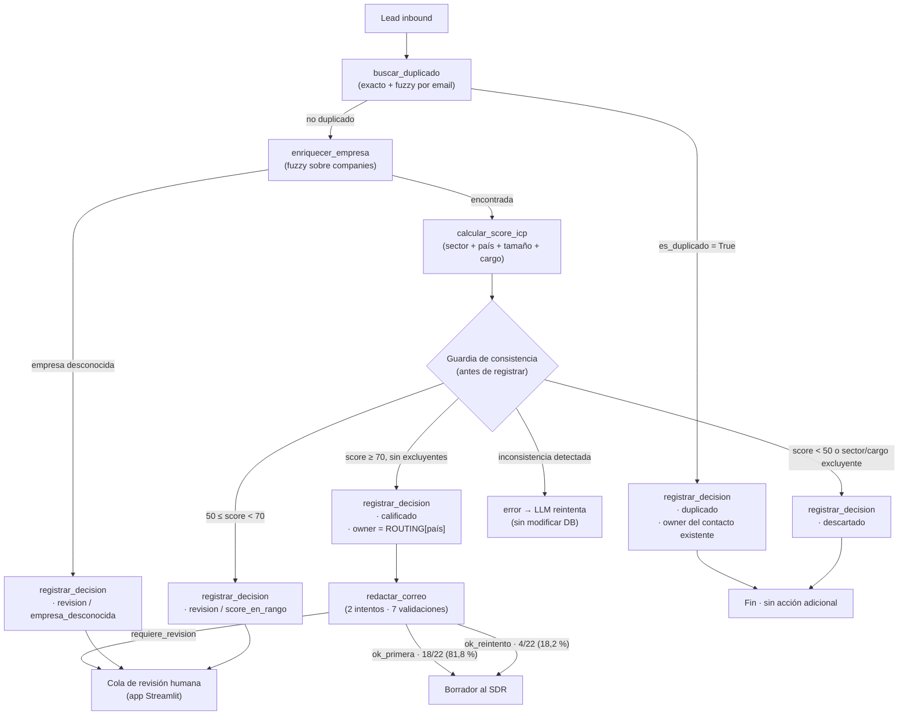

# Lead Triage Agent

Agente de IA que clasifica leads inbound B2B, asigna un SDR y redacta el primer correo de contacto — con evaluación reproducible y un dashboard para revisión humana.

---

## El problema

[ESCRIBE AQUÍ]

---

## Arquitectura

El agente sigue un loop de tool-calling: el LLM decide qué herramienta invocar en cada paso; las herramientas ejecutan lógica determinística en Python y devuelven resultados; el LLM interpreta y decide el siguiente paso. La decisión final se registra solo si pasa la guardia de consistencia.



### Componentes

| Capa | Archivo | Responsabilidad |
|------|---------|-----------------|
| Loop del agente | `src/agent/loop.py` | Llama al modelo, ejecuta tool calls, mantiene historial, aplica guardia |
| Herramientas | `src/agent/tools.py` | `buscar_duplicado`, `enriquecer_empresa`, `calcular_score_icp`, `registrar_decision` |
| Reglas de negocio | `src/agent/rules.py` | Constantes ICP, umbrales, routing de SDRs — única fuente de verdad |
| Redactor de correos | `src/email/drafter.py` | 2 intentos con 7 validaciones determinísticas |
| CRM simulado | `data/crm.db` | SQLite: `inbound_leads`, `companies`, `crm_contacts`, `agent_decisions`, `email_drafts`, `human_overrides` |
| Evaluación | `eval/run_eval.py` | Corre N repeticiones, separa errores de sistema, genera reporte Markdown + CSV |
| Dashboard | `app/` | Streamlit: triage en vivo, cola de revisión humana, métricas de test |

---

## Decisiones de diseño

### El LLM orquesta; los cálculos los hace Python

El modelo decide *qué* herramienta invocar y en qué orden. Los valores numéricos (score ICP, umbrales, routing) los calculan funciones Python determinísticas que leen de la DB por `lead_id`. El LLM nunca recibe los valores intermedios para "copiarlos" al siguiente paso: `calcular_score_icp` acepta `lead_id` + `nombre_empresa` y recupera `sector`, `país` y `empleados` directamente de `companies`.

**Por qué:** un LLM que recibe `score=75` y lo reenvía como argumento puede cometer errores de transcripción, redondear, o confabular. Que el código lea de la DB garantiza que el score que registra es el mismo que calculó la herramienta.

### El owner es determinístico, no lo decide el LLM

`registrar_decision` calcula el owner internamente (`_compute_owner`) en función de la decisión y el país de la empresa. No es un parámetro que el LLM provea.

**Por qué:** el routing de SDRs es una regla de negocio explícita. Si el LLM lo eligiera, habría riesgo de asignaciones inventadas o inconsistentes entre corridas.

### Guardia de consistencia antes de registrar

`_check_consistency` valida que la decisión que el LLM propone sea coherente con los resultados de las herramientas de esa misma ejecución: no puede registrar `calificado` si no llamó a `calcular_score_icp`, ni `duplicado` si `buscar_duplicado` dijo que no hay match, ni `revision/score_en_rango_revision` si el score supera el umbral de calificado.

**Por qué:** sin guardia, el LLM puede "recordar mal" un resultado o malinterpretar los umbrales. La guardia convierte esos errores en feedback inmediato al modelo en lugar de dejar pasar decisiones incorrectas.

### `revision` requiere motivo de lista cerrada

Los motivos válidos son tres: `score_en_rango_revision`, `empresa_desconocida`, `datos_contradictorios`. El contenido descargado no es criterio de revisión (regla explícita en el system prompt). `datos_contradictorios` requiere además un campo `evidencia` con los dos datos en conflicto.

**Por qué:** un motivo libre ("no estoy seguro") es inútil para la persona que revisa la cola. La lista cerrada obliga al agente a identificar la causa real y hace el escalamiento trazable.

### Dev/test split rígido y test corrido una sola vez

100 leads con ground truth derivado de reglas. Split 30/70 (dev/test). El set dev se usa para iterar el prompt; el set test se corre una única vez con el prompt congelado en el tag `prompt-v1`.

**Por qué:** correr el test repetidas veces con el mismo prompt permitiría ajustarlo implícitamente a esos 70 casos. Una sola corrida mantiene el test como medida honesta de generalización.

### Tres corridas por evaluación, no una

Cada evaluación lanza el agente N veces sobre los mismos leads y agrega media y rango `[min, max]`.

**Por qué:** Qwen3 con temperatura 0.6 produce variabilidad real entre corridas. Un único run puede ser atípico. Tres runs muestran la variabilidad y distinguen errores reproducibles (mismo lead falla siempre) de errores estocásticos (mismo lead falla 1/3 veces).

### Temperatura 0.6 / top_p 0.95, no temperatura 0

Qwen3 en modo pensamiento (*extended thinking*) requiere temperatura > 0 para activar el razonamiento interno. Con temperatura 0 el modelo responde sin `reasoning_content`.

**Por qué:** el razonamiento interno mejora la calidad de las decisiones y es visible en el dashboard para trazabilidad. Desactivarlo ahorraría tokens pero degradaría la orquestación.

### Errores de sistema excluidos de las métricas de accuracy

`error_sistema` se registra cuando una excepción Python no atribuible al LLM interrumpe la ejecución (timeout de red, fallo de DB, etc.). Esos casos se reportan aparte y se excluyen del denominador de accuracy.

**Por qué:** incluirlos inflaría o contaminaría la accuracy. Si un error de infraestructura cae en la decisión correcta por coincidencia (o en la incorrecta por fallback), distorsionaría la medición del juicio del modelo.

---

## Metodología de evaluación

### Ground truth por reglas

El ground truth (`eval/ground_truth.csv`) se genera con `scripts/generate_data.py` (seed = 42). Cada lead tiene `case_type`, `decision` esperada y `owner_esperado` derivados de las mismas reglas de negocio que usa el agente. No hay etiquetado manual: si las reglas dicen que el lead es `calificado`, el ground truth dice `calificado`.

Esto garantiza consistencia perfecta entre el criterio de evaluación y la implementación, pero implica que la evaluación mide fidelidad a las reglas, no calidad de negocio real.

### Sets y proporciones

| Set | Leads | Uso |
|-----|------:|-----|
| dev | 30 | Desarrollo e iteración del prompt |
| test | 70 | Medición final, corrido una sola vez |

### Distribución de case_types (test, 70 leads)

| case_type | n (×1 run) | Descripción |
|-----------|:----------:|-------------|
| normal | 33 | Lead estándar con toda la información |
| duplicado_exacto | 7 | Email idéntico al CRM |
| duplicado_fuzzy | 6 | Email similar (typo o variante) |
| empresa_desconocida | 6 | Empresa sin match en `companies` |
| datos_contradictorios | 5 | País vs. dominio de email inconsistentes |
| cargo_ambiguo | 5 | Cargo que puede ser decisor o no |
| fuera_icp | 8 | Sector o país fuera del ICP |

### Protocolo de runs

```
python eval/run_eval.py --set test --model Qwen3.6-35B-A3B-4bit --runs 3
```

Cada run tiene un `run_id` único (`{set}_{model}_{fecha}_R{n}`). El script computa métricas por run, agrega media y rango, y genera un reporte Markdown + CSV de errores.

### Qué se mide

- **Accuracy de decisión:** proporción de leads donde la decisión del agente coincide con el ground truth, excluyendo errores de sistema.
- **Accuracy de owner:** ídem para el SDR asignado.
- **F1 de duplicados:** precision/recall/F1 sobre el subconjunto de leads `duplicado`.
- **Tasa de escalamiento:** proporción de leads con decisión `revision`.
- **Guardia de consistencia activada:** número de veces que `_check_consistency` rechazó un intento de `registrar_decision`.
- **Fallbacks por step_limit:** veces que el loop alcanzó MAX\_STEPS sin decisión final.
- **Errores de sistema:** fallos de infraestructura, excluidos de accuracy.

---

## Resultados — test v1

> Set test · 70 leads · 3 runs · prompt-v1 congelado · Qwen3.6-35B-A3B-4bit · T=0.6 / top_p=0.95

### Resumen ejecutivo

| Métrica | Media | [min, max] |
|---------|------:|:----------:|
| Accuracy de decisión | **95,7 %** | [92,9 %, 97,1 %] |
| Accuracy de owner | **97,1 %** | [94,3 %, 98,6 %] |
| Precision duplicados | 92,9 % | — |
| Recall duplicados | **100,0 %** | — |
| F1 duplicados | 96,3 % | — |
| Tasa de escalamiento | 28,6 % | [27,1 %, 31,4 %] |
| Guardia de consistencia activada | 0,3 veces/run | [0,0, 1,0] |
| Fallbacks por step_limit | 2,7 veces/run | [2,0, 4,0] |
| Errores de sistema | 0,0 | — |
| Pasos promedio | 3,37 | [3,27, 3,46] |
| Latencia promedio | 24,7 s/lead | [18,3, 34,3] |

### Resultado por run

| Run | Acc. decisión | Acc. owner | Dup. F1 | Pasos | Latencia | Errores |
|:---:|:-------------:|:----------:|:-------:|------:|---------:|:-------:|
| R1 | 92,9 % | 94,3 % | 96 % | 3,3 | 34,3 s | 5 |
| R2 | 97,1 % | 98,6 % | 96 % | 3,4 | 21,5 s | 2 |
| R3 | 97,1 % | 98,6 % | 96 % | 3,5 | 18,3 s | 2 |

### Accuracy por case_type (agregada, 3 runs)

| case_type | n (×3) | correctos | accuracy |
|-----------|-------:|----------:|:--------:|
| datos_contradictorios | 15 | 15 | **100,0 %** |
| duplicado_exacto | 21 | 21 | **100,0 %** |
| duplicado_fuzzy | 18 | 18 | **100,0 %** |
| empresa_desconocida | 18 | 18 | **100,0 %** |
| fuera_icp | 24 | 24 | **100,0 %** |
| normal | 99 | 92 | 92,9 % |
| cargo_ambiguo | 15 | 13 | 86,7 % |

### Errores por origen (9 instancias en 6 leads únicos)

| Origen | Leads únicos | Instancias | Reproducible |
|--------|:------------:|:----------:|:------------:|
| Orquestación — respuesta sin `tool_calls` → fallback `step_limit` | 4 (#43, #78, #80, #94) | 5 | No (1–2/3 runs) |
| Herramienta determinística — umbral fuzzy demasiado bajo | 1 (#72) | 3 | Sí (3/3 runs) |
| Juicio del LLM — regla del prompt ignorada | 1 (#45) | 1 | No (1/3 runs) |

**Detalle de los casos:**

- **Leads #43, #78, #80, #94 (orquestación):** en alguna corrida el modelo emitió texto plano sin `tool_calls`. El loop lo interpreta como fin de turno y activa el fallback `step_limit → revision`. Las corridas del mismo lead que sí completan el flujo producen la decisión correcta.
- **Lead #72 (herramienta):** `buscar_duplicado` siempre detecta a Natalia Sánchez (`natalia.sanchez@patagoniawind.com`) como duplicada de Natalia Silva (`natalia.silva@patagoniawind.com`) porque `fuzz.ratio = 87,5 % > umbral 85 %`. Son personas distintas del mismo dominio. El LLM actúa correctamente según el resultado de la herramienta; el error está en el umbral.
- **Lead #45 (juicio):** el modelo obtuvo `score=80` (calificado) pero razonó que el contenido descargado contradice el país del lead y registró `revision/datos_contradictorios`. El system prompt dice explícitamente que el contenido descargado no es criterio de decisión.

### Accuracy de decisión vs. owner

La accuracy de owner (97,1 %) es mayor que la de decisión (95,7 %) porque el lead #72 produce errores de *decisión* sin producir errores de *owner*: tanto la decisión incorrecta (`duplicado`) como la correcta (`calificado`) convergen en el mismo SDR (`Ana Torres`, propietaria del contacto en CRM y responsable de Argentina en el routing).

### Resultados de correos (R3 de test)

22 leads calificados en R3 → 22 borradores generados (cobertura 100 %).

| Estado | n | % | Intentos |
|--------|--:|:-:|:--------:|
| `ok_primera` | 18 | 81,8 % | 1 |
| `ok_reintento` | 4 | 18,2 % | 2 |
| `requiere_revision` | 0 | 0,0 % | — |

Cada borrador pasa 7 validaciones determinísticas: longitud de cuerpo (≤ 120 palabras), longitud de asunto (≤ 8 palabras), idioma (español / portugués según país), mención de la empresa, firma con nombre del SDR, y ausencia de cifras no presentes en los datos de entrada. Si el primer intento falla, el prompt del segundo intento incluye el error específico.

La revisión humana de los borradores está disponible en la cola del dashboard pero aún no tiene registros: el flujo de aprobación manual no se ejecutó sobre este set.

---

## Lo que aprendí

[ESCRIBE AQUÍ]

---

## Limitaciones

### Datos 100 % sintéticos

Empresas, personas, emails y contenidos son ficticios generados con seed fija. No hay garantía de que el agente se comporte igual con leads reales, que presentan ruido, formatos inesperados, empresas con nombres ambiguos y contextos fuera del ICP diseñado.

### Modelo local no comparado

Se usó un único modelo (Qwen3.6-35B-A3B-4bit en oMLX local). No hay comparación con otros modelos, tamaños o providers. Los resultados no son extrapolables a "LLMs en general".

### Una sola versión del prompt evaluada en test

El set test se corrió una vez con `prompt-v1`. Aunque el prompt se desarrolló sobre el set dev, 70 casos es un conjunto pequeño y los resultados podrían no generalizar a distribuciones distintas de leads o a casos edge no representados.

### CRM simulado en SQLite sin historial ni oportunidades

La DB contiene `crm_contacts` y `companies` pero no historial de interacciones, oportunidades abiertas ni estados del ciclo de ventas. Un agente real necesitaría integración con un CRM real (HubSpot, Salesforce) y contexto de relación previa.

### Latencia de 24,7 s/lead con modelo local

A esa velocidad, procesar 100 leads nuevos tomaría ~41 minutos. Para volúmenes altos sería necesario un modelo más rápido (API externa, modelo más pequeño) o procesamiento en paralelo.

### El ground truth mide fidelidad a las reglas, no valor de negocio

La evaluación comprueba que el agente aplica correctamente las reglas del YAML. No mide si esas reglas son las correctas, si el ICP está bien definido, ni si los leads clasificados como `calificado` convierten en la realidad.

---

## Cómo ejecutarlo desde cero

### Requisitos

- Python 3.11
- [oMLX](https://github.com/ml-explore/mlx-lm) corriendo localmente con un modelo compatible (p. ej. `Qwen3.6-35B-A3B-4bit`)

### Instalación

```bash
# 1. Clonar
git clone <repo-url>
cd lead-triage-agent

# 2. Crear entorno
conda create -n leadagent python=3.11
conda activate leadagent
pip install -r requirements.txt

# 3. Variables de entorno
cp .env.example .env
# Editar .env:
#   OMLX_BASE_URL=http://127.0.0.1:8000/v1
#   OMLX_API_KEY=<tu-api-key>
#   MODEL_ID=Qwen3.6-35B-A3B-4bit

# 4. Generar datos sintéticos y CRM (seed=42, reproducible)
python scripts/generate_data.py
```

### Dashboard

```bash
streamlit run app/main.py
# Abre http://localhost:8501
```

### Evaluar

```bash
# Set de desarrollo (30 leads, iterable)
python eval/run_eval.py --set dev --model Qwen3.6-35B-A3B-4bit --runs 3

# Set de test — correr UNA SOLA VEZ con el prompt congelado
python eval/run_eval.py --set test --model Qwen3.6-35B-A3B-4bit --runs 3
```

### Tests unitarios

```bash
pytest -v
```

### Generar correos para leads calificados

```bash
# Genera borradores para todos los leads calificados del último run de test
python scripts/draft_emails.py
```

### Estructura del proyecto

```
lead-triage-agent/
├── app/                    # Dashboard Streamlit
│   ├── main.py
│   ├── db.py
│   └── pages/
│       ├── 1_Triage_en_vivo.py
│       ├── 2_Cola_de_revision.py
│       └── 3_Evaluacion.py
├── config/
│   └── business_rules.yaml # Umbrales ICP, routing, reglas de correo
├── data/
│   └── crm.db              # SQLite (generado por generate_data.py)
├── docs/
│   ├── analisis_errores_test.md
│   └── lecciones.md
├── eval/
│   ├── ground_truth.csv
│   ├── run_eval.py
│   ├── split.json
│   └── results/
├── prompts/
│   ├── systems_prompt.md
│   └── email_prompt.md
├── scripts/
│   ├── generate_data.py
│   └── draft_emails.py
├── src/
│   ├── agent/
│   │   ├── loop.py
│   │   ├── tools.py
│   │   └── rules.py
│   └── email/
│       └── drafter.py
├── tests/
└── requirements.txt
```

---

## Dashboard — capturas

[AGREGA CAPTURAS AQUÍ]

<!-- Sugerencia de estructura:


-->
